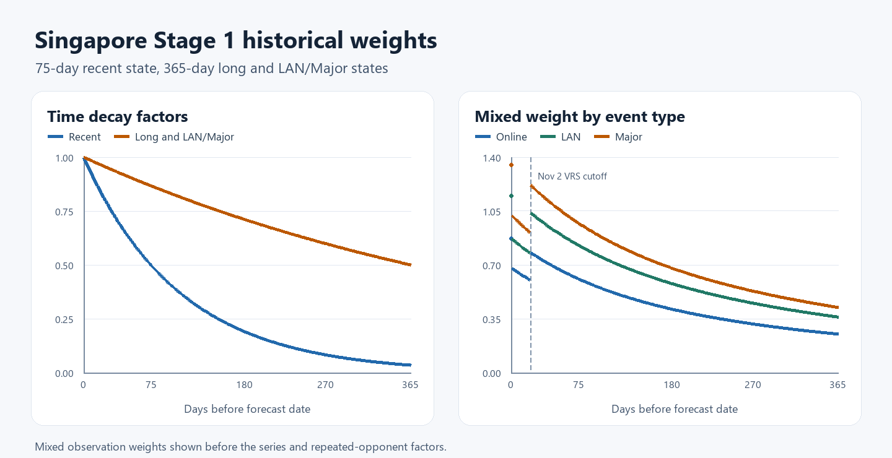

# Singapore Stage 1 模型与复跑

本阶段在首轮开打前一次性选择十支队伍。模型拟合全部可用的赛前历史，再对 16 支参赛队生成逐图胜率、瑞士轮赛果和竞猜组合。 [阶段结果](README.md) · [正式结果 JSON](result.json)

## 冻结输入

| 项目 | 正式运行口径 |
| --- | --- |
| 阶段配置 | 16 支队伍、种子与五人名单。地图池为 Ancient、Anubis、Cache、Dust2、Inferno、Mirage、Nuke。[配置](stage.json) |
| 比赛数据 | `data/datasets/` 的 HLTV 规范 JSONL。最新快照收录 10,849 场系列赛，正式拟合使用 24,388 张有胜负的实打地图，覆盖 934 支队伍、2,841 套队伍阵容和 7,304 对对手。 |
| 数据清单 | SHA-256 为 `8e2dc1d11cadd9023899cf92b85026ba0fb75660f7b878e6f4244102b9b76130`。 |
| 比赛截止 | `2026-11-24T04:00:00Z`。参考日为 11 月 24 日 UTC。 |
| 排名参照 | Valve 全球 VRS 2026-11-02 快照。该日也作为长记忆赛事权重的折扣界线。 |
| 首轮赔率 | 8 个 Polymarket 比赛市场，统一锁定到 `2026-11-24T04:00:00Z`。各场最后一组配对快照时间均为 `2026-11-23T16:00:00Z`。[盘口清单](markets.json) · [冻结价格历史](market_history.json) |

模型按 UTC 日期筛选比赛。截止日当天优先用 `played_at_utc`，其次用 `completed_at_utc`，保留时间不晚于截止且有时间戳的记录。更早的记录可以只有日期。选手行按已保留的比赛 ID 过滤。数据快照保存了当时采集的 Rating，较早比赛的评分可能已由来源重算。11 月 2 日补回了 10 个缓存比赛页，其中包括北京站首日遗漏的 5 场，11 月 19–23 日的结果页也完成了全窗口复核。

一条训练记录是一张有胜负的实打地图，携带双方 ID、当天上场名单、地图、胜方、回合比分和三种观测权重。逐图阵容优先，缺失时用该场系列赛阵容。Default、弃赛判定图及无胜方的图不作为标签。参赛队使用阶段配置的名单，其余队伍使用截止前最后一次实打地图记录的名单。原始记录保留来源 ID 和 Rating 版本。

## 历史地图怎样加权

设 `d` 为比赛到参考日的 UTC 日数，`Q = 1 + 0.15 × I(LAN) + 0.20 × I(Major)`。代码以赛事名中的 `major` 标记 Major，同时将 Major 视为 LAN。`D` 在 2026-11-02 之后且参考日前取 `0.60`，其余日期取 `1`。`L` 在 LAN 或 Major 取 `1`，线上取 `0.15`。

| 状态 | 每张图的权重 | 合并系数 |
| --- | --- | ---: |
| 近期 `recent` | `Q × 2^(-d/75)` | 0.40 |
| 长期 `long` | `Q × 2^(-d/365) × D` | 0.45 |
| LAN/Major `lan_major` | `Q × 2^(-d/365) × D × L` | 0.15 |

75 天半衰期反映当前状态，365 天半衰期让更早的战绩继续发挥作用。VRS 截止后的比赛对近期状态照常生效，长期与赛事状态按 `D` 折算。赛事加权保留更多 LAN 和 Major 证据。两条时间曲线和实际赛事权重如下。



同一系列赛有 `m` 张用于拟合的地图、同一对队伍在历史数据中交手 `n` 场时，每张图额外乘 `1/√m × 1/√n`。这使多图系列赛提供更多证据，同时减少同一场和重复对同一队的相关赛果对实力估计的支配。全局实力拟合使用三种观测权重的加权和，再乘这个因子。地图和克制残差按三个状态分别拟合，同样乘这个系列赛与对手因子。

## 全局实力与阵容

模型给每个实际的「队伍 ID × 上场阵容」估计一个全局实力分 `s`。单图胜负的基础概率为 `sigmoid(s_A - s_B)`。所有纳入的队伍和阵容通过历史对局的边一起拟合，边上记录加权胜场和加权总场量。对手分数参与解释每场胜负，未参加本阶段的队伍也能沿比赛网络影响参赛队。模型一次拟合全体阵容，再读取目标阵容的分数。

全局实力使用 L2 强度 `1.0` 和阵容/VRS 先验，通过 Newton-CG 求解。每张图的胜负仍是主信号，回合比分以连续的相对回合差调整这张图的证据权重，当前权重为 `1 + 0.5 × |胜者回合差|/(总回合数)`。这让 13–11 和 13–2 的信息量不同，同时保留原始的胜负标签。给定旧阵容与目标阵容共享 `k` 人，令 `N = max(5, 两份阵容长度)`，`r = (k/N)^1.5`。旧阵容条件先验的均值为 `r × s_目标`，方差为 `(1-r²)/L2`。同一支队伍的相同阵容共用一个分数。完全不同的阵容获得各自的正则化实力估计，双方仍可通过对手网络联系。

| 五人名单重合人数 | 1 | 2 | 3 | 4 | 5 |
| --- | ---: | ---: | ---: | ---: | ---: |
| 阵容继承 `r` | 8.9% | 28.3% | 46.5% | 71.6% | 100% |
| 保留搭档比例 `q` | 0% | 10% | 30% | 60% | 100% |

这套关系逐场读取实际阵容，临时替补和永久换人使用同一口径。替补出场的地图归给当时阵容，常用五人的其他战绩仍归给常用阵容。`r` 还用于球队地图特征、BP 和阶段波动的继承。

VRS 给跨赛程连接较弱的阵容提供外部参照。历史尺度拟合使用严格早于比赛日期的最近一份全球 VRS，按同名队伍和阵容昵称匹配，优先取重合人数最高的一条，重合人数相同时取名次靠前的一条。两侧各有可靠度 `r × 2^(-快照年龄/75)`，历史 VRS 积分差的拟合权重乘两侧可靠度和系列赛与对手因子。16,409 个带有 VRS 连接的地图观测给出每 1,000 VRS 分约 `2.1968270` 的基础 logit 差。

预测时以 11 月 2 日全球快照的均值 `849.5293` 为中心，使排名先验的均值为 `2.1968270 × (VRS 分 - 849.5293) / 1000`，强度为 `8 × r × 2^(-快照年龄/75)`。345 支队伍取得先验。没有对应排名或名单完全不同的队伍从比赛图和正则化估计实力。 [阶段内全局分与 VRS 对照](vrs.md) · [Valve 全球快照](https://github.com/ValveSoftware/counter-strike_regional_standings/blob/f8c55f250fdef796d708aa32814587932154fa04/invitation/2026/standings_global_2026_11_02.md)

## 地图、克制、阵容与阶段状态

固定全局阵容实力差作为地图模型的 offset，分别为近期、长期、赛事状态拟合地图和克制残差。三个加权稀疏 logistic 拟合各跑 14 轮，基础 L2 为 `0.04`，初始学习率 `0.65` 按轮次平方根衰减。最终用 `0.40 / 0.45 / 0.15` 合成残差 logit，再加基础实力差。双方互换时，特征和 logit 同时变号。

| 残差 | 特征 | 额外 L2 | 拟合后的倍率 |
| --- | --- | ---: | ---: |
| 队伍地图 `team_map` | 队伍与地图，同侧历史特征乘阵容继承 `r` | 4 | 0.2960113082029133 |
| 对手地图 `style` | 无序队伍对与地图，正负号随队序变化，历史特征乘两侧保留搭档比例 `q_A × q_B` | 8 | 0.2960113082029133 |

五人阵容中 `q = k(k-1)/20`，通用分母为 `N(N-1)`。旧交手任一队只剩一人时，这场的专属地图克制贡献为零。旧比赛仍然能通过全局实力、地图权重和阵容交接项起作用。五人组合的长期协作信息已包含在阵容实力分中。赛制与 LAN/Major 通过赛事权重和比赛模拟使用，逐图 logit 由上表特征决定。

选手数据只取 HLTV `scope=series`、`map_name=All maps` 且版本为 `3.0` 的 Rating。模型先在每场比赛内部减去同队其他上场选手的平均 Rating，得到选手相对队友的表现，再以 75 天半衰期和有效样本量收缩。这个量只用于阵容从历史五人组过渡到目标五人组时的均值偏移，形式为新旧选手相对队友表现差的加权和，并乘阵容继承系数。固定阵容的 Rating 信息通过阵容交接项参与。当前 `roster_rating_scale=1.0`。

## 阶段模拟与地图 BP

**阶段状态。** 使用严格按时间留出的三段 21 天窗口。每场先用窗口开始前的数据预测，再按队伍视角计算 `(y-p)/√max(0.05, p(1-p))`，把不同对手的系列赛残差配对，估计能跨系列赛延续的共同状态。总体二阶矩和队伍二阶矩向彼此收缩，标准差乘 `0.22` 并限制在 `0.10–0.75`。选手 Rating 通过阵容交接项改变均值，阵容继承和全局强度方差提供阵容不确定性。正式拟合使用 2026-09-22、2026-10-13 和 2026-11-03 起的三段窗口，共 4,921 个可配对系列赛残差。

**模拟扰动。** 全局分的估计方差用拟合后 Hessian 对角元素的倒数近似。每条瑞士轮路径给每队抽取一次均值为 0 的正态扰动，方差为状态方差与实力方差之和，实力标准差倍率为 `1.0`。同一扰动贯穿整条路径，逐图 logit 加 `扰动_A - 扰动_B`，让同队在不同轮次的发挥相关。

**BP 权重。** 从历史 veto 原文读取各队禁图、选图次数，按系列赛实际阵容的 `r` 及 75 天半衰期加权。总体实打地图频次也按 75 天衰减。每回合在剩余地图中，禁图以 `该队禁图次数 + 1` 为权重归一化。选图权重用 `(总体频次+5) × (1+2×选图率) × (1-0.5×禁图率)`，两种比率都用加 1 平滑与当前剩余池大小。以历史行为推断地图倾向，样本少时平滑让其他图也保有概率。

**BP 规则。** 高种子选择 Team A 或 Team B，模型给两个位置各 `50%`。两种分配均按七图的官方顺序枚举可行路径，路径权重为每步条件概率之积。 [Valve 规则](https://github.com/ValveSoftware/counter-strike_rules_and_regs/blob/main/major-supplemental-rulebook.md)

- **BO1** 依次 A 禁两张、B 禁三张、A 禁一张，打最后剩的一张。BO1 数据胜率为逐图胜率按剩图概率加权的和。
- **BO3** 依次 A 禁、B 禁、A 选第一图、B 选第二图、B 禁、A 禁，最后一张为决胜图。给定路径的三图胜率 `a,b,c`，系列赛胜率为 `ab + [a(1-b)+(1-a)b]c`，再对各路径加权。模拟抽取路径并逐图打到两胜。

输出对 16 队的 `16 × 15 × 7` 个有方向的对手与地图单元给出胜率，同时算出两队的 BO1/BO3 概率。展示矩阵使用均值实力和阶段状态 0，仅用赛前比赛数据；首轮融合另列。观赛表中的历史胜率直接数实打地图，近 90 日只是展示窗口，模型强度指数为对其余 15 队 BO1 的 logit 取均值再转回百分比。 [逐图矩阵](matrix_3d.md) · [含 BO3 的原始矩阵](result.json)

## 赔率融合

采集器从 Gamma 元数据解析两侧 token，取 Polymarket CLOB `prices-history`，每个 3,600 秒桶对齐两侧各自的最后一条价格。只保存两侧都有效且总和为正的配对，使用 `p_market = Yes / (Yes+No)`。历史文件记录市场和队伍映射、token、时间桶、原价和来源摘要。冻结文件有 2,560 条配对快照，始于 `2026-11-10T09:00:00Z`，采集于 `2026-11-23T16:12:59Z`。流动性、成交量和价差来自采集时的元数据，历史订单簿深度和逐时价差未知。 [冻结赔率](market_history.json)

首轮每场使用统一截止前最新的快照，并按预测队伍方向取市场概率或其补数。设 `p_data` 为该条模拟路径的阶段扰动下、对 BP 加权后的 BO1 数据概率。

```text
logit(p_first_round) = 0.75 × logit(p_data) + 0.25 × logit(p_market)
```

输入 logit 前将概率限于 `[10^-6, 1-10^-6]`。首轮直接用融合后的赛果概率抽样。缺少合格快照的首轮场次和后续各轮使用数据模型及地图抽样。`lambda_match=0.25` 是工作先验，全部八场使用统一权重。本阶段的晋级概率由模拟产生。README 的首轮融合列用阶段状态 0 的概率计算。

## 瑞士轮与 Pick'Em

首轮种子为 1 对 9、2 对 10，依次到 8 对 16。每轮先根据轮前状态生成全部对阵。3 胜晋级、3 负淘汰，第一、二轮与第三轮的 1–1 组用 BO1，晋级与淘汰赛用 BO3。

第二、三轮按当前战绩分组，先按已遇对手胜负差之和（Buchholz）降序，再按初始种子排序。高位队对可配的最低位队，回溯避免重赛。第四、五轮六队组按 Valve 15 行优先表选择首个无重赛配对。若找不到无重赛匹配，取重赛最少且优先级靠前的配对。规则实现标为 `valve-major-swiss-2026`。 [Valve 瑞士轮规则](https://github.com/ValveSoftware/counter-strike_rules_and_regs/blob/main/major-supplemental-rulebook.md#swiss-bracket)

一条模拟保留 16 队的联合最终战绩。每份竞猜从 16 队分配 2 个 3–0、6 个 3–1/3–2、2 个 0–3，同队只能占一格。逐条模拟按对应战绩计分，最大化 `P(正确数 ≥ 5)`，通过率相等时按期望命中数排序。

1. 主模拟生成 500,000 条路径，8 个 CPU 进程并行计算。抽取其中 100,000 条用于候选搜索。
2. 每种槽位各取对应战绩边际概率前 12 队，用位集合并计算整套卡在每条路径上的得分。在候选池内做联合搜索，按剩余槽位能达到的通过率上界剪枝。
3. 把搜索入围的 5 组用全部 500,000 条主路径重测并排序。搜索样本用于减少搜索成本，因此结果标记为候选池内的最优，未声称覆盖全部合法组合。
4. 另抽 500,000 条路径评估固定五组。单组报告二项抽样的 95% 模拟区间，同一批验证赛果也给出候选通过率差的配对区间。

本次修正后的首选主模拟通过率为 25.64%，独立模拟为 25.54%，期望命中分别为 3.59 和 3.59。独立验证中首选比第二名高 0.136 个百分点，95% 模拟区间为 +0.012 至 +0.260 个百分点。区间量化模拟抽样误差。历史赛事回放只覆盖 Cologne 2026 一届，实际预测还受数据覆盖、模型参数与盘口权重的影响。 [最终组合和边际概率](README.md)

## 运行命令

从仓库根目录运行。查看定稿展示时用 `render-report` 读取冻结的 `result.json`。

```powershell
python -m 2026_singapore.stage1.run render-report
```

下面的命令使用正式模型参数，把重跑的结果保存到本地运行目录。使用上表的冻结数据清单和已保存的赔率。

```powershell
python -m 2026_singapore.stage1.run predict-stage `
  --stage-file 2026_singapore/stage1/stage.json --epochs 14 --l2 0.04 `
  --roster-overlap-exponent 1.5 --opponent-saturation-exponent 0.5 --strength-uncertainty-scale 1.0 `
  --simulations 500000 --search-simulations 100000 --candidate-k 12 `
  --validation-simulations 500000 --workers 8 --seed 20261125 --validation-seed 20261126 `
  --market-file 2026_singapore/stage1/market_history.json `
  --market-lock-at 2026-11-24T04:00:00Z --lambda-match 0.25 `
  --output data/reports/runs/singapore-stage1-rerun.json
```

冻结主运行使用种子 `20261125`，独立验证使用种子 `20261126`，两批均由 8 个 CPU 进程生成。并行入口从各自的基准种子派生每个进程的字符串种子，所以固定种子和进程数可以重现同一批路径。 [冻结运行结果](result.json)

需要更新价格时，采集命令写入单独的输出路径。指定锁定时间与对阵清单后，可以在重跑命令选择该文件。

```powershell
python -m data.pipeline.polymarket `
  --market-file 2026_singapore/stage1/markets.json `
  --output data/reports/runs/singapore-stage1-market-refresh.json `
  --interval max --bucket-seconds 3600 --refresh
```
